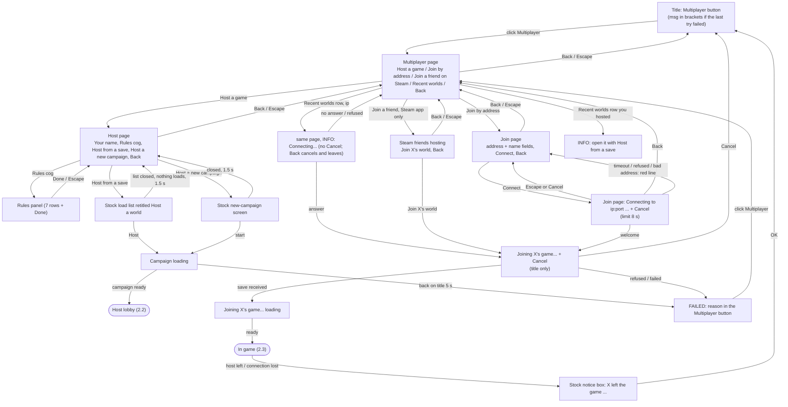
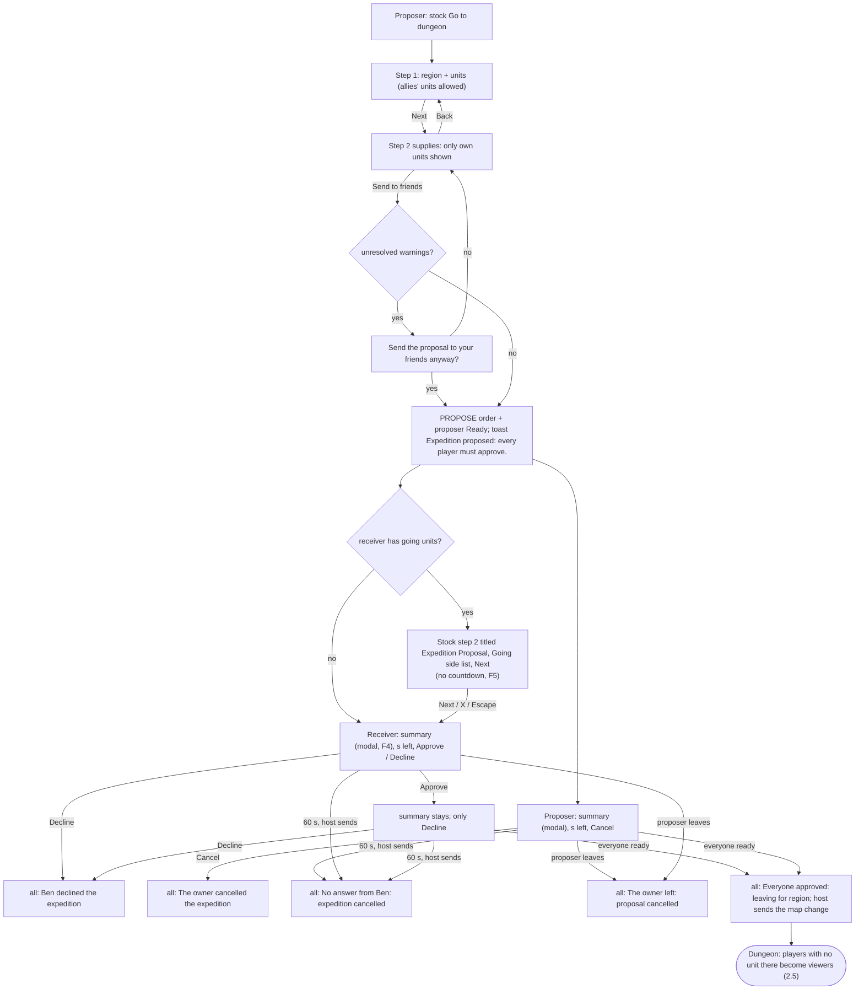
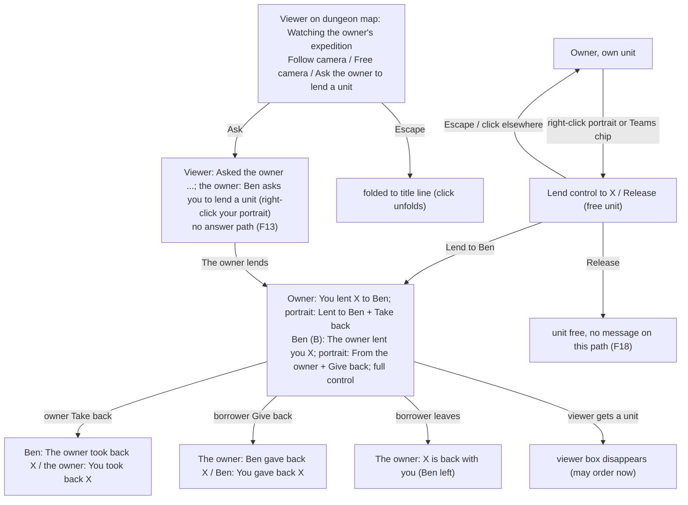
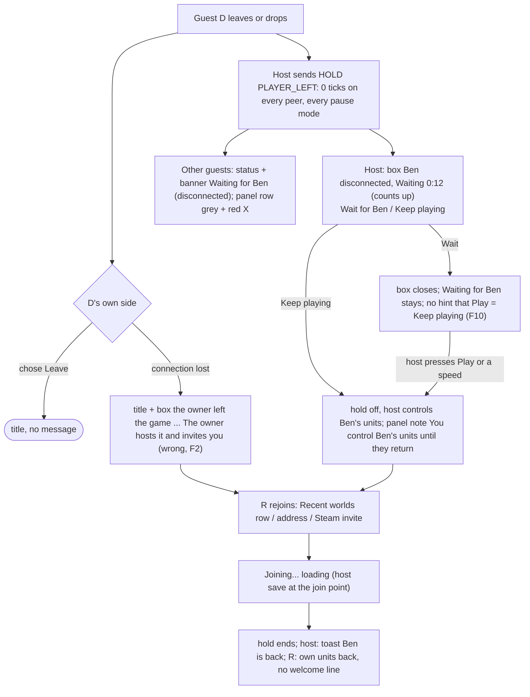

# Multiplayer mod: UX flow from the code (lan_v10, 2026-10-14)

Source read: `src/mpmenu.c`, `src/mpmenu_model.c`, `src/ui_game.c`, `src/ui_model.c`, `src/ui_teams.c`, `src/ui_teams_model.c`, `src/ord_mp.c`, `src/ord_game.c` (gear / pick-up checks), `src/mp_game.c` and `src/mp_core.c` (session end, leave, hold), `src/net/dsnet.h`. PLAN.md read first; owner decisions there count as requirements.
Method: code only. No game copy was started, no pair was leased. Every finding cites file:line. A finding marked **(check)** follows from the code, but one test in a pair must confirm it.
Not repeated here: the 30 items of `research/ux_review_2026-10-13.md`. Most of them are fixed in the current source (non-blocking connect, proposer strip with Cancel and countdown, host-left notice box, guest Save greyed, Esc menu no longer pauses, pause text from one function).

## 1. TLDR: top findings, ranked (severity x frequency)

| # | Finding | Severity | Frequency | Where |
|---|---|---|---|---|
| F1 | Return screen: the picker can close the Portal window with its X. No order goes out. The others keep a read-only Portal (X greyed) and stay paused. | blocker (check) | sometimes | ui_game.c:1157-1239 |
| F2 | A guest whose own connection drops is told "The owner left the game ... To play again, the owner hosts it". The host is in fact waiting for him. | major | sometimes | mp_game.c:602-606, mpmenu_model.c:67-74 |
| F3 | Story events: only "Majority vote" has a time limit. In "Owner of the unit", "Host only" and "First to answer", an away chooser pauses everyone with no limit and no countdown. | major | sometimes | ui_game.c:1700-1707, 1575-1595 |
| F4 | The expedition proposal summary blocks all world input for every player for up to 60 s. The world keeps running. After you approve, the window stays (only Decline left). | major | sometimes | ui_teams.c:1791-1795, 1229-1238, 1180-1192 |
| F5 | A receiver who packs supplies sees no countdown. The 60 s run from the proposal start. Packing can time out the whole expedition with no warning. | major | sometimes | ui_teams.c:1197-1213, 1584-1622 |
| F6 | "Units per player" caps ownership and recruiting, not only the run. PLAN line 50 says any number of units in base, max 3 per run. Ask the owner which rule wins. | major (rule) | sometimes | ord_mp.c:38-49, ui_game.c:3343-3349, ui_game.c:470, mpmenu_model.c:24 |
| F7 | Host "Leave multiplayer" (lobby and in-game Esc menu) ends the session for everyone at once. No confirm. | major | rare | mpmenu_model.c:181, 188; mpmenu.c:2200-2206 |
| F8 | A refused join after a Steam invite (other version, full game) shows the reason only as small bracket text in the Multiplayer button. | major | rare | mpmenu_model.c:65, 203-205, 244 |
| F9 | Steam invite accepted during a single-player game: no "Joining..." line, no Cancel, and the host save replaces the running game. **(check)** | major (check) | rare | mp_game.c:540, 631-640; mpmenu_model.c:235 |
| F10 | Disconnect wait: guests only see "Waiting for Ben (disconnected)". No time, no hint who decides. After "Wait", nothing tells the host that Play switches to "Keep playing". | minor | often | ui_game.c:750, 852-857; mp_core.c:320 |

Full list with the other 12 findings: section 3. Palette verdict: section 4. Test-session tasks: section 5.

## 2. Flowcharts (per area, per role)

Roles: **H** host, **G** guest, **V** viewer (no unit it may order on the dungeon map), **B** borrower (a unit is lent to it), **D** disconnected player, **R** rejoining player.

### 2.1 Title menus (mpmenu_model.c:101-211, mpm_visible 213-239)



### 2.2 Lobby (mpmenu.c:1178-1400, 2236-2250; mpmenu_model.c:168-202)

```mermaid
flowchart TD
    subgraph Host
      HL["Lobby window on the Esc view<br/>Players + bars, Invite (Steam invite, Copy), Rules (read), Leave, Start<br/>world held: DSNET_HOLD_LOBBY"]
      HR["Rules panel over the window (arrows, Done)"]
      HLX["Lobby window hidden for a ui box (disconnect / map vote) or a stock popup"]
    end
    subgraph Guest
      GW["Guest waiting window: X's Lobby<br/>Players, Rules (Set by the host), Leave"]
    end
    HL -->|cog| HR
    HR -->|Done / Escape| HL
    HR -->|arrow: rules sent to all| HR
    HL -->|Escape with Rules closed| ESC1["Esc view closes; lobby reopens within 0.5 s (F14)"]
    ESC1 --> HL
    HL -->|ui box or popup opens| HLX
    HLX -->|box closed| HL
    HL -->|Copy| HL2["button reads Copied 1 s"] --> HL
    HL -->|Steam invite| OVL["Steam overlay (LAN app: greyed, Needs the Steam version)"]
    HL -->|Start| HP(["In game, hold off"])
    HL -->|Leave, no confirm (F7)| SP["Host stays in the world, single player, guests sent to title"]
    GW -->|host presses Start| GP(["In game"])
    GW -->|Leave| T(["Title at once"])
    GW -->|host leaves| N(["Title + notice box"])
```

### 2.3 In game: HUD, orders, votes, popups (ui_game.c)

```mermaid
flowchart TD
    W(["World, MP running"])
    W -->|right-click own portrait| LM["Lend menu (2.5)"]
    W -->|right-click free portrait| CL["You take X / at most N units (host rule)"]
    W -->|right-click other's portrait| DN["X belongs to Ben (+ Admin hint for host)"]
    W -->|order on a unit not mine| RF["Toast: X: Not your unit (owned by Ben)<br/>free unit: ... Right-click its portrait to take it"]
    W -->|select other's unit| BN["Owned by Ben banner, skill bar greyed;<br/>slot click: same toast"]
    W -->|pause / speed button| PV["Panel status: Paused by A, B / You want Fast, waiting for B / B wants Fast, press >> to agree"]
    W -->|Enter| CH["Chat box focused; Enter sends, Escape closes; others see X is typing..."]
    W -->|Escape| EO{"ours open?"}
    EO -->|chat / lobby rules / Teams| C1["closes ours"]
    EO -->|lend menu, then panel cog, then viewer box| C2["closes / folds ours"]
    EO -->|none| ESCM["Esc menu: no pause; Steam invite (host), Leave multiplayer;<br/>Load greyed (Leave multiplayer to load another world); guest Save greyed"]
    W -->|floor exit or map change| MV["Map vote"]
    MV -->|proposer| STRIP["Strip: Go down to floor 3? Waiting for Ben (1 of 2) 52 s + Cancel"]
    MV -->|others| YN["Yes/No box with marks and s left"]
    STRIP & YN -->|all yes| GO["Toast Everyone agreed: going down; map change for all"]
    STRIP & YN -->|a no / Cancel / 60 s| NO["Toast Ben said no / cancelled / no answer"]
    W -->|story event| ST{"Event choices rule"}
    ST -->|owner / host| SC["chooser: buttons; others: greyed + X chooses (no limit, F3)"]
    ST -->|first| SF["everyone can click; first wins"]
    ST -->|majority| SV["Vote n of m, host breaks ties; closes at 60 s (no countdown, F11)"]
    W -->|level-up / trade| LU["opens for the unit's owner only; others: trade toast"]
    W -->|exit portal| RS{"picker?"}
    RS -->|picker| RP["Portal screen: Return / Go Down / X"]
    RS -->|others| RO["Read-only Portal: X is choosing who returns, buttons and X greyed"]
    RP -->|Return / Go Down| RG["one order, all go"]
    RP -->|X close| STUCK["others keep read-only screen, paused (F1)"]
    W -->|desync| RSY["Toast Ben's game went out of sync: reloading everyone"]
```



### 2.4 Expedition proposal (ui_teams.c:237-355, 1046-1240, 1497-1790)



### 2.5 Lending and viewer (ui_game.c:2779-3125, ui_teams.c:758-860)



### 2.6 Disconnect and rejoin (mp_core.c:115-160, 317-322; ui_game.c:793-899; mp_game.c:596-616)



## 3. All findings with file:line and fixes

Severity: blocker (a state with no way out, or wrong game result), major (users get stuck, confused or act on false info), minor, polish. Frequency: often (most sessions), sometimes (some sessions), rare.

### Blocker
**F1. Return screen closed by the picker leaves the others stuck (check).** `result_opened` (ui_game.c:1157-1170) opens the read-only copies and holds the pause (`story_pause(1)`). The copies close only in `result_go_order` (ui_game.c:1181-1189, `result_close = 1`), which runs only after Return or Go Down. The picker's X (visible in frame 35b) closes the stock view locally; `result_frame` (1221-1238) then clears only the picker's own state. On the others, `result_readonly_frame` (1192-1219) greys every Selectable, the X too. Their screens stay, and their popup holds keep everyone paused. The stock Escape may still close it on their side, but nothing says so.
Fix: hook the view's close on the picker (X and Escape) and send one "result closed" order; every peer closes its copy and releases the holds. Line on the copies: "The owner is choosing who returns. If the owner closes it, the run goes on."
Frequency: sometimes (a player who walks into the exit portal and decides to stay presses X).

### Major
**F2. Own connection loss is reported as "the host left".** mp_game.c:602-606 maps every guest disconnect (`dsnet_is_disconnected`, which includes the 5 s silence limit, dsnet.h:311) to "The host left the game". mpmenu_model.c:69-72 turns that into "The owner left the game. The world is saved on the owner's computer. To play again, the owner hosts it and invites you." But the host stays in the world and holds it for this player (mp_core.c:128-135). The guest believes the session is over and does not rejoin.
Fix: two texts. Host sent a leave or closed the socket cleanly: as now. Silence / socket error: "Connection to the owner lost. The owner's game waits for you: open Multiplayer, then the world in Recent worlds."

**F3. Story event with an absent chooser has no limit.** The 60 s close exists only for `UI_STORY_VOTE` (ui_game.c:1700-1707). With "Owner of the unit" (default), "Host only" and "First to answer", a chooser who is in another window, away from the keyboard, or whose game is loading holds everyone paused. The title line says "Ben chooses" with no time (1575-1595). PLAN line 79: "never a dead vote".
Fix: after 60 s, the host decides (owner rule: host breaks ties). Title: "Ben chooses · 45 s, then the owner decides".

**F4. The proposal summary is modal for everyone while the world runs.** `hk_over_ui` returns "over UI" for the whole screen while `prop_shown` (ui_teams.c:1791-1795). `prop_click` eats every click (1229-1238). Nothing in the proposal code pauses the game (no pause call in ui_teams.c). For up to 60 s nobody can order units, and monsters at base keep acting. After Approve, the window stays (`show_ok` false, 1180-1186); the only button left is Decline, which cancels the expedition for all.
Fix (owner choice, ask): (a) pause everyone while a proposal is open, like the map vote; or (b) after Approve, fold the summary to a strip "Waiting for Ben · 40 s · [Open]" and give world input back.

**F5. No countdown in the receiver's supplies step.** The clock starts at the PROPOSE order (ui_teams.c:291). The host sends the timeout at 60 s (1210-1213). The receiver first gets the stock supplies window (1199-1205); `stock_setup` only sets the title "Expedition Proposal" and the Going block (1606-1613). A friend who packs slowly gets "No answer from Ben: expedition cancelled" with no warning.
Fix: title "Expedition Proposal · 42 s left" (update each second), or start the 60 s when the last receiver reaches the summary.

**F6. "Units per player" is an ownership and recruit cap (rule check).** Recruit is refused at the cap (ord_mp.c:38-49 and the click check ui_game.c:3343-3349: "You already have 3 units: host rule Units per player"). Claim is refused (ui_game.c:470). The rule tip says "The most units each player can control" (mpmenu_model.c:24). PLAN line 50: "A player can own any number of units in base; at most 3 of his units go into a dungeon." PLAN line 68 later adds the host rule 1/2/3/4/6 without saying what it limits. The run limit (Teams header "n/3 for the run", ui_teams_model.c:169) and the ownership limit use the same number.
Fix: ask the owner. If line 50 holds, keep the rule for the run only and let recruits and claims go above it.

**F7. Host Leave ends everyone's game with no confirm.** Lobby Leave (mpmenu_model.c:181) and in-game Esc "Leave multiplayer" (188) run `MPA_LEAVE` at once (mpmenu.c:2200-2206). For the host, every guest goes to the title. The host stays in the world as single player with no message (`mp_steam_leave` hides the own-choice message, mp_game.c:660-664).
Fix: host only, the stock CommonNoticeView: "End the game for everyone? Ben goes back to the title. The world stays on your computer." [Cancel] [End]. After End: toast "You are playing alone now".

**F8. Refused Steam-invite join: reason in tiny text.** A join that fails after an invite goes `GUEST_JOINING -> fail()` (mpmenu_model.c:205, 65). `MPM_FAILED` shows only the Multiplayer button, with the reason at 60 % in brackets (244). Review #9 moved only "host left" to the notice box (67-74).
Fix: `fail()` fills `m->notice` too, so the same box shows "Could not join the owner's game: your game version is different ...".

**F9. Invite accepted during a single-player game (check).** mp_game.c:631-640 joins as soon as Steam reports an accepted invite, in any scene. `mp_game_join` sets `need_save` with the comment "a lobby joiner is on the title screen" (mp_game.c:540). The status line and Cancel show only on the title (mpmenu_model.c:235). If the host save loads over a running single-player world, unsaved progress is lost with no question.
Fix: in scene 2 with no session, ask first with the stock box: "Join the owner's game? Your current game is not saved." [Stay] [Save and join]; show "Joining the owner's game..." in the HUD status.

### Minor
**F10. The disconnect wait says little.** Guests see "Waiting for Ben (disconnected)" (ui_game.c:750) with no time and no "The owner decides". The host's box has the clock (852-857), but after "Wait" it closes and the only way to "Keep playing" later is to press Play or a speed button (mp_core.c:320, mp_game.c:74). Nothing on screen says this. In "No pause" mode the pause button is hidden (ui_game.c:665); check that a speed button still triggers it.
Fix: host panel status "Waiting for Ben · 1:20 · press Play to keep playing with his units"; guests "Waiting for Ben (disconnected) · 1:20 · The owner decides".

**F11. Story majority: limit with no countdown.** 60 s close (ui_game.c:1700-1707); title "Vote · 1 of 2 · host breaks ties" (1590). Add "· 42 s".

**F12. Admin mode and in-game rule changes are silent for guests.** Admin on/off (ui_game.c:2225-2233; lobby mpmenu.c:2196-2203) and "Units per player" in play (ui_game.c:2258-2269) send no message. Admin mode lets the host order every guest unit.
Fix: centre message on every peer: "The owner turned Admin mode on: the host can control every unit." / "Units per player is now 2 (host rule)".

**F13. Viewer "Ask to lend" has no answer path.** One toast on the leader (ui_game.c:3006-3010); the viewer gets "Asked the owner..." (3020-3026) and then nothing. No cooldown (only the 1.5 s duplicate filter, 208).
Fix: on the leader, a small strip "Ben asks for a unit [Lend X] [No]" for 15 s; the answer goes back as a toast. Disable the button 10 s after a press.

**F14. Lobby: Escape blinks the window.** With the Rules closed, Escape closes the stock Esc view that carries the lobby; `mpmenu_frame` reopens it within 30 frames (mpmenu.c:2240-2249). It looks broken.
Fix: `mpmenu_escape_ours` (mpmenu.c:1903-1912) returns 1 while `M.state` is LOBBY or GUEST_LOBBY.

**F15. Proposal summary: Escape does nothing visible.** `mpmenu_escape_ours` swallows Escape while `teams_modal()` (mpmenu.c:1909); `ui_teams_frame` handles Escape only for the Teams window (ui_teams.c:1973-1981). PLAN line 100: Escape closes our interfaces "where allowed".
Fix: if F4 (b) is chosen, Escape folds the summary. Else toast "Approve or Decline the proposal (42 s left)".

**F16. Back and Escape differ while connecting.** On the join page, Escape while connecting cancels and stays (mpmenu_model.c:108, 142); Back cancels and leaves (143). A Recent worlds reconnect has no Cancel; Back cancels and leaves the page (129, 218). `GUEST_JOINING` has a Cancel button but Escape is not mapped (105-109).
Fix: one rule: Escape = the visible Cancel if there is one, else Back. Add Cancel to the Multiplayer page while `connecting`.

**F17. Recent worlds row may join another world (check).** The IP row connects to the stored address (mpmenu.c:1848-1857). No campaign id is compared. If that host now hosts another world, the guest lands there while the row said the old world name.
Fix: compare the world GUID in the welcome; if different: "The owner is hosting another world now (World B). Join it?".

**F18. Silent actions.** Steam invite failure is only logged (mpmenu.c:2199). Chat send failure is only logged (mpmenu.c:2079). "Release (free unit)" from the lend menu shows no toast (ui_game.c:2792-2801), the portrait path does (461). "The Teams screen is not available here" gives no reason (ui_teams.c:1323).
Fix: "Steam overlay is off: use Copy direct address", "Message not sent (connection)", "You release X", "Teams opens on the world map only".

**F19. Gear-mode refusal has no message (check).** `gear_ok` refuses an equip with a log line only (ord_game.c:598-609). The item-owner refusal has one (ord_mp.c:72-80). Most paths are greyed by the "Owned by" banner (ui_game.c:2626 on), so check whether a storage drag onto another player's unit still reaches `gear_ok`.
Fix: toast "Gear rule: you can only equip your own units".

**F20. Two boxes share one CommonNoticeView.** Only the first leaver gets a box (`ids[0]`, ui_game.c:874-897). A map vote that arrives while the disconnect box is up calls `prompt_show` on the same view (912-927); `left_prompt` stays 1, the host never sees the "Wait / Keep playing" choice again. Rare (3+ players).

### Polish (unreachable UI code: risk of stale text if re-enabled)
**F21.** Teams Ready / Go button: `u_active(o, false)` then `if (0 && ...)` (ui_teams.c:998-1011); "Waiting for" list `else if (0 && wm)` (1032-1038); right-click marking: `click_at` sends only button 0 (1339), so `tm_click_unit` button 1 and the texts "You already marked...", "Right-click 1 to 3 of your units...", "You can only mark your own units" (1283-1286) never show. Old host-page buttons `MPB_PAUSE_MODE / MPB_SPEEDUP / MPB_GEAR` are not in `mpm_visible` (mpmenu_model.c:152-154, 274-276). `lobby_text` and `lobby_layout` have no caller (mpmenu.c:1025-1110). `ui_player_row/2/3` with "ms" text are unused (ui_model.c:431-520; PLAN line 66: never milliseconds). Comment at ui_teams.c:1497-1500 still says Go to dungeon "opens the Teams screen".
**F22.** A Recent worlds row you hosted only says "open it with Host a game > Host from a save" (mpmenu.c:1838). It could open the load list directly.

### Checked and fine
Map vote: both sides have a countdown and names (ui_game.c:905-972). Refused orders always say why (ui_game.c:632-656). Lend events tell both sides (2863-2887). Escape order in game is clear and documented (3120-3141). Join errors are specific (mpmenu.c:1629-1634). Disconnect box counts up (852-857). Recruit refusals say which rule (3347-3349).

## 4. Colour-blind check of the player palette

Method: `colors[]` at ui_model.c:20. Each colour simulated with the Machado 2009 matrices, severity 1.0, applied in linear sRGB (protanopia, deutanopia, tritanopia), then CIELAB D65 and CIEDE2000. The CIEDE2000 code matches the Sharma 2005 test pairs (2.0425, 1.0000, 1.2644). Scripts: `research/palette_cvd/cvd.py` (palette report), `search4.py` and `ext3.py` (searches). Threshold: 10.

### Current palette: fails
| Vision | Smallest pair | Pairs below 10 | Min vs #222025 |
|---|---|---|---|
| normal | 10.9 gold #F2C14E / peach #FFD9A0 | none | 53.9 |
| protanopia | **3.2** blue #5DADE2 / pink #E88BD4 | 4: blue/pink 3.2, blue/periwinkle #9AA7FF 4.8, pink/periwinkle 6.8, cyan #4FD1D9 / ice #B8E0FF 7.2 | 49.7 |
| deuteranopia | **2.6** pink #E88BD4 / cyan #4FD1D9 | 4: pink/cyan 2.6, blue/periwinkle 4.3, cyan/ice 7.8, blue/pink 9.1 | 49.7 |
| tritanopia | 8.2 gold / peach | 2: gold/peach 8.2, blue/cyan 8.3 | 56.5 |

Also: gold #F2C14E is 11.2 from the orange "weak link" bar #ea9f3d in normal vision and 6.0 under colour blindness; 5.0 from the bright green #7CFC00. Peach #FFD9A0 and white #F4F4F4 sit 10-13 from the cream body text #ccbeb8, so a coloured name can look like plain text. The owner's worry (blue / periwinkle / ice / cyan) is confirmed for protanopia and deuteranopia; the worst pair is in fact blue or cyan against pink.

### What is possible
Rules used: no red, orange, green, teal, purple hue (LCh hue bands 15-75, 100-170, 170-215, 290-325 for chroma 12+); lightness L* 60+ (readable small text on #222025); 10+ from cream body text and the grey "away" #8a8088.
- 4 colours: easy. Best design-led set, min 13.3 in every vision.
- 8 colours, all pairs 10+ in every vision: found one (min 10.7). Cost: slot 6 must be gold, which is only 3.2 from the orange bar and 5.4 from the green bar under colour blindness.
- 8 colours that also keep 10+ from every status colour: not found (best 7.9). The search is a grid with step 0x11 plus a local search, so this is strong evidence, not a proof.

### Proposed palette (slot order = join order; most sessions use slots 1-4)
| Slot | Colour | Name | L* |
|---|---|---|---|
| 1 | #FFEE88 | yellow | 94 |
| 2 | #44AAFF | blue | 67 |
| 3 | #DD66BB | pink | 60 |
| 4 | #EEF6FF | white | 97 |
| 5 | #AA9988 | taupe | 64 |
| 6 | #DDAA00 | gold | 72 |
| 7 | #BBBBCC | silver | 76 |
| 8 | #AACCFF | light blue | 81 |

| Vision | Slots 1-4 min | Slots 1-8 min | Min vs #222025 |
|---|---|---|---|
| normal | 27.4 | 13.6 | 46.0 |
| protanopia | 13.6 | 10.8 | 38.8 |
| deuteranopia | 13.3 | 11.8 | 44.3 |
| tritanopia | 18.6 | 10.7 | 45.6 |

Known costs (for the owner to accept or not): slot 6 gold vs orange bar (3.2 colour-blind), pink vs red #f16071 8.4 under one simulation, yellow vs bright green #7CFC00 8.5 under one simulation, taupe and silver are muted. Recommendation: use this order, AND put the slot number in each player's dot (panel, lobby, Teams, proposal rows). Colour then never carries the meaning alone; this also covers 5-8 players.

## 5. First recorded test with a friend: task list

Ask the friend to think aloud. Record both screens. Do not help unless they are stuck for 2 minutes; note where.

1. **Join by address.** Host reads the address from the lobby (Copy). Friend: Multiplayer > Join by address, type it, Connect. Watch: does the friend find the field and know the ip:port form? Time to join. What they say while "Connecting..." runs.
2. **Read the lobby.** Friend: "What are the rules of this game?" Watch: do they find the Rules column and understand "Set by the host"? Host then presses Start: does the friend notice the game started?
3. **Take a unit.** Friend: get two units to control. Watch: Teams button or portrait right-click? Do they understand "Free units"? What happens at the unit limit message?
4. **Try to order someone else's unit.** Friend: select one of the host's units and move it. Watch: do they read "Not your unit (owned by the owner)" and the greyed skill bar? Do they think it is a bug?
5. **Lend a unit.** Host lends a unit to the friend (right-click portrait > Lend control). Friend then gives it back. Watch: do both see who controls it (portrait label, colour)? Does the friend find "Give back"?
6. **Pause and speed.** Friend pauses, then asks for fast speed. Watch: does the host understand "Paused by Ben" and "Ben wants Fast · press >> to agree"?
7. **Chat.** Each sends one message. Watch: does Enter work at once? Do they see "is typing..."? Do they find old messages again?
8. **Propose an expedition.** Friend presses the game's Go to dungeon, picks the region and units, packs supplies, Send to friends. Host approves. Watch (F4, F5): the time left during packing, what they do while the summary blocks the screen, whether they find Approve.
9. **Watch mode.** Send only the host's units. Friend is a viewer. Watch: does the friend understand "Watching the owner's expedition"? Do they try Follow camera and Ask to lend?
10. **Floor vote and return.** Host takes the stairs down (vote), later uses the exit portal; once press X on the Portal screen instead of choosing (F1). Watch: is the friend stuck? What does the friend think is going on?
11. **Story event.** If one shows: who may choose, and how long the others wait (F3).
12. **Disconnect and rejoin.** Friend turns Wi-Fi off for 20 s, then on. Watch (F2, F10): the message the friend gets, whether they find Recent worlds to come back, what the host sees and chooses (Wait / Keep playing), whether the friend gets the same units back.

Afterwards ask: "What was the most confusing moment?" and "Which colour were you?" (colour recognition check, section 4).
